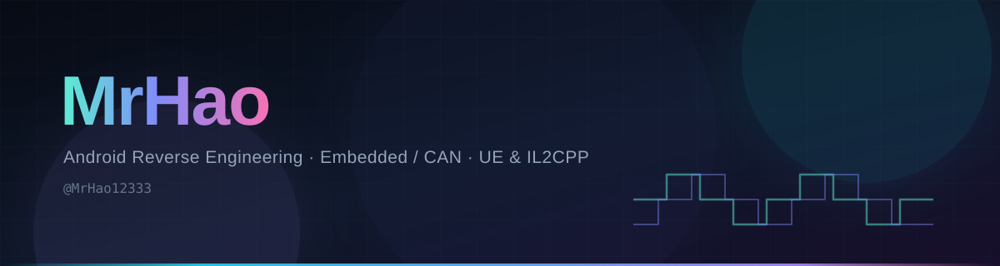

  

## 研究方向

- 🔬 **Android 逆向 / 注入**：IL2CPP、Unreal Engine Dumper、Zygote 注入、自定义 linker、JNI trace
- 🚗 **嵌入式 / 车载总线**：ESP32-P4 / C5 上的 Tesla CAN 工具，TWAI 多路、注入时序、TLSSC / R79 / Nag
- 🧰 **方法论**：静态优先（IDA / Ghidra / Smali 重打包），产物可复现；只在自有设备与封闭场地验证

## 我维护的

| 项目 | 说明 | 状态 |
|---|---|---|
| **C5can** | `P4can-unlock-more` 的 ESP32-C5 移植：双路 TWAI + 原生 Wi-Fi + TLSSC 免重启 | private |

## 在跟踪的上游项目

> 本账号里大量仓库是 **fork**，用于跟踪、复现和学习，**不代表原创**。下面直接链到上游原作者：

| 方向 | 上游项目 |
|---|---|
| Tesla CAN 固件 | [P4can-universal-unlock](https://github.com/06066060606060/P4can-universal-unlock) · [P4can-No-Reboot](https://github.com/baicyber/P4can-No-Reboot) |
| IL2CPP / UE Dump | [Il2CppDumper](https://github.com/Perfare/Il2CppDumper) · [AndUEDumper](https://github.com/MJx0/AndUEDumper) |
| Android 注入 / linker | [fake-linker](https://github.com/sanfengAndroid/fake-linker) · [AndKittyInjector](https://github.com/MJx0/AndKittyInjector) |
| Android 基础设施 | [xDL](https://github.com/hexhacking/xDL) · [eDBG](https://github.com/ShinoLeah/eDBG) · [cpp-httplib](https://github.com/yhirose/cpp-httplib) |

## 技术栈

## GitHub 统计

  
  

  

  「静态优先，产物可复现」— 所有研究仅用于自有设备与封闭场地

